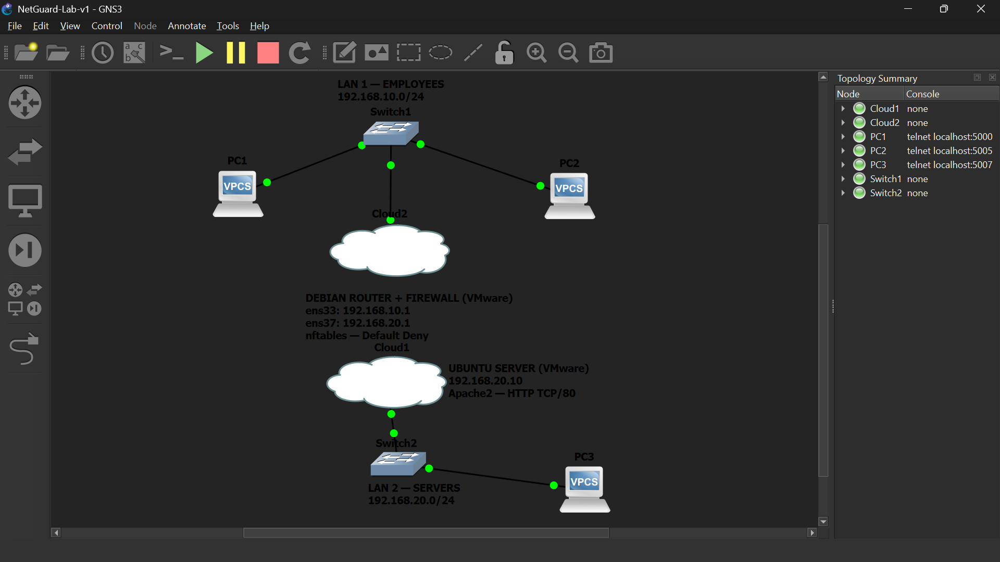
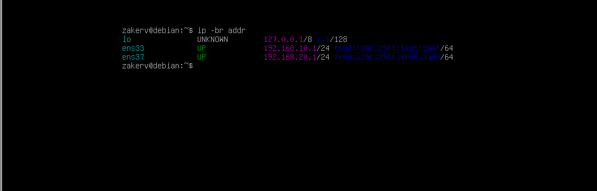
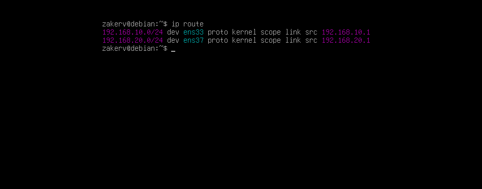
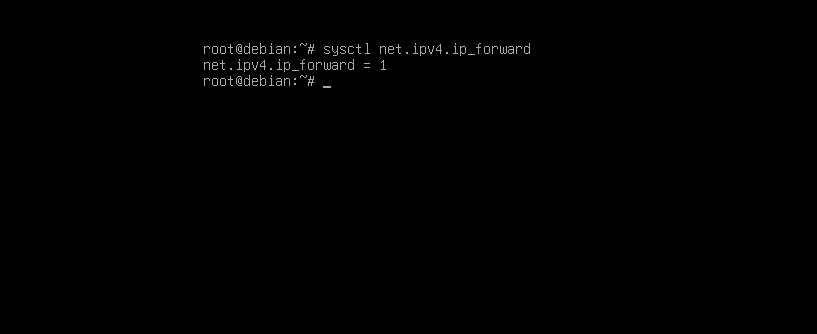
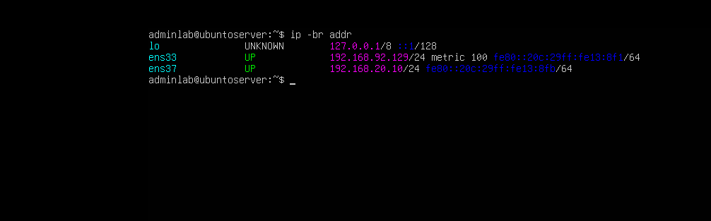
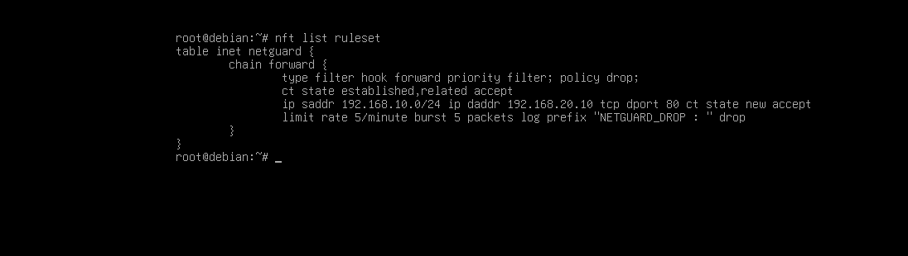
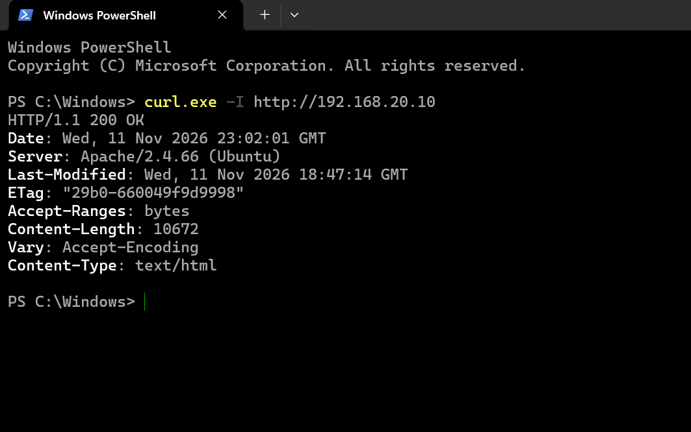
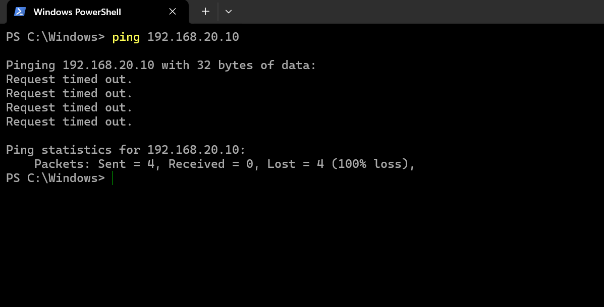
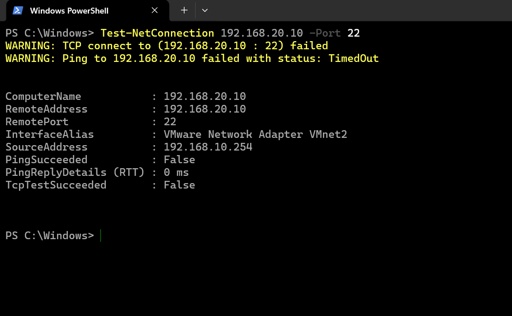
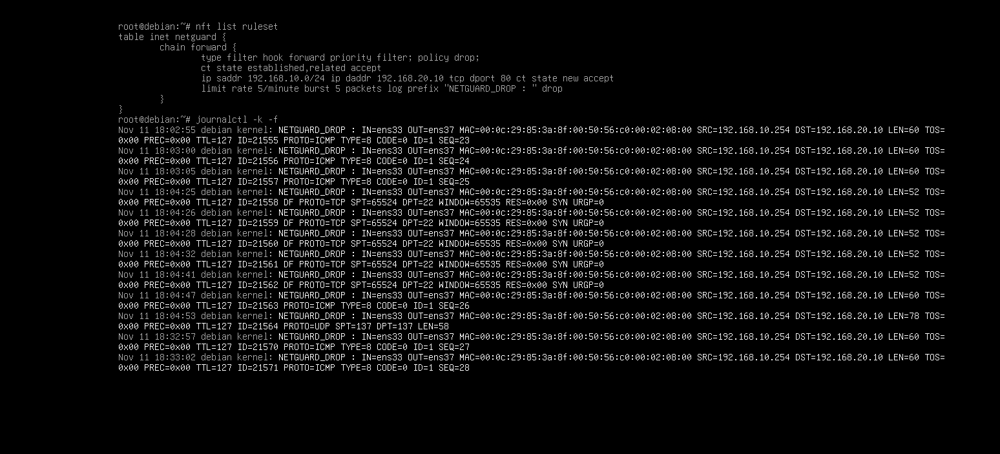

# 🛡️ NetGuard Lab
### Network Segmentation | Linux Routing | Stateful Firewall Security


## 📖 Overview

**NetGuard Lab** is a hands-on network security project designed to simulate a small enterprise network using virtualized infrastructure.

The project focuses on implementing network segmentation, configuring Linux-based routing, and enforcing network security policies through a stateful firewall.

Built using **GNS3, VMware Workstation, Debian Linux, Ubuntu Server, and nftables**, this lab demonstrates how network traffic can be controlled and monitored between separate network segments.

The main objective is to allow legitimate communication while blocking unauthorized traffic.

---

## 🎯 Project Objectives

- Design a segmented network architecture.
- Configure IPv4 addressing and default gateways.
- Enable routing between two isolated subnets.
- Deploy a Linux-based firewall using nftables.
- Implement a default-deny forwarding policy.
- Allow authorized HTTP communication.
- Block unauthorized ICMP and SSH traffic.
- Monitor dropped packets through firewall logs.
- Validate security policies using practical network tests.

---

## 🏗️ Network Architecture

The network consists of two subnets connected through a Debian Linux router acting as a firewall.

```text
                      NETGUARD LAB
                 NETWORK ARCHITECTURE

               LAN 1 — EMPLOYEES
                 192.168.10.0/24
                          |
           +--------------+--------------+
           |              |              |
          PC1            PC2        Windows Host
     192.168.10.10  192.168.10.11  192.168.10.254
           |              |              |
           +--------------+--------------+
                          |
                  GNS3 / VMnet2
                          |
                +------------------+
                |   DEBIAN ROUTER  |
                |     FIREWALL     |
                |                  |
                | ens33: 10.1      |
                | ens37: 20.1      |
                |                  |
                |     nftables     |
                +------------------+
                          |
                  GNS3 / VMnet1
                          |
           +--------------+--------------+
           |                             |
      Ubuntu Server                     PC3
     192.168.20.10                192.168.20.20
       Apache HTTP
           |                             |
           +--------------+--------------+
                          |
                LAN 2 — SERVERS
                 192.168.20.0/24
```

The Debian router provides Layer 3 connectivity between the two subnets and filters forwarded packets according to the configured security policy.

---

## 🌐 IP Addressing Plan

| Device | Interface | IP Address | Role |
|---|---|---|---|
| PC1 | LAN1 | `192.168.10.10/24` | Employee workstation |
| PC2 | LAN1 | `192.168.10.11/24` | Employee workstation |
| Windows Host | VMnet2 | `192.168.10.254/24` | Testing workstation |
| Debian Router | ens33 | `192.168.10.1/24` | LAN1 gateway |
| Debian Router | ens37 | `192.168.20.1/24` | LAN2 gateway |
| Ubuntu Server | ens37 | `192.168.20.10/24` | Apache web server |
| PC3 | LAN2 | `192.168.20.20/24` | Server-network workstation |

### Default Gateways

**LAN1:** `192.168.10.1`

**LAN2:** `192.168.20.1`

The Ubuntu Server also has a separate NAT-connected interface used for management.

---

## 🧰 Technologies & Tools

| Technology | Purpose |
|---|---|
| GNS3 | Network topology design and emulation |
| VMware Workstation | Virtual machine hosting |
| Debian Linux | Router and firewall |
| Ubuntu Server | Web server |
| nftables | Stateful packet filtering |
| Apache2 | HTTP service |
| VPCS | Virtual client simulation |
| Wireshark | Optional packet analysis |
| Linux CLI | Network configuration and troubleshooting |

---

## ⚙️ Network Configuration

### 1. Enable IPv4 Forwarding

IPv4 forwarding must be enabled on the Debian router to allow traffic to pass between network interfaces.

Check the current setting:

```bash
sysctl net.ipv4.ip_forward
```

Enable forwarding:

```bash
sudo sysctl -w net.ipv4.ip_forward=1
```

To make the setting persistent, add the following line to a sysctl configuration file:

```text
net.ipv4.ip_forward=1
```

### 2. Verify Network Interfaces

```bash
ip -br addr
```

Expected router interfaces:

```text
ens33    192.168.10.1/24
ens37    192.168.20.1/24
```

### 3. Verify Routing

```bash
ip route
```

The router should have connected routes to both subnets.

---

## 🔐 Firewall Implementation

NetGuard Lab uses **nftables**, the modern Linux packet filtering framework.

The firewall applies a default-deny policy to forwarded traffic.

### Security Policy

| Protocol | Source | Destination | Action |
|---|---|---|---|
| HTTP TCP/80 | LAN1 | Ubuntu Server | ✅ ALLOW |
| ICMP Echo | LAN1 | Ubuntu Server | ❌ DROP |
| SSH TCP/22 | LAN1 | Ubuntu Server | ❌ DROP |
| Established / Related | Existing connections | Return traffic | ✅ ALLOW |
| Other forwarded traffic | Any | Any | ❌ DROP |

### nftables Configuration

```nft
table inet netguard {
    chain forward {
        type filter hook forward priority 0;
        policy drop;

        ct state established,related accept

        ip saddr 192.168.10.0/24 \
        ip daddr 192.168.20.10 \
        tcp dport 80 \
        ct state new accept

        limit rate 5/minute burst 5 packets \
        log prefix "NETGUARD_DROP : " drop
    }
}
```

### Explanation

**Default DROP Policy**

All forwarded traffic is blocked unless explicitly permitted.

**Stateful Filtering**

The firewall tracks established and related connections using connection tracking.

**HTTP Access Rule**

Clients from LAN1 are permitted to initiate HTTP connections to the Ubuntu Server on TCP port 80.

**Logging**

Dropped packets are logged with the prefix `NETGUARD_DROP`, subject to rate limiting.

**Scope:** This ruleset filters forwarded traffic. It does not independently restrict traffic addressed to the Debian router itself.

---

## 🧪 Security Testing & Validation

The configured firewall was tested to verify that the security policy works as intended.

### Test 1 — HTTP Communication

**Objective:** Verify that clients from LAN1 can access the Apache web server.

Command:

```bash
curl -I http://192.168.20.10
```

Observed response:

```text
HTTP/1.1 200 OK
```

**Result: PASS**

Authorized HTTP traffic successfully traversed the firewall.

### Test 2 — ICMP Filtering

**Objective:** Verify that ICMP Echo traffic from LAN1 to the Ubuntu Server is blocked.

Command:

```bash
ping 192.168.20.10
```

**Result: PASS**

ICMP Echo traffic was blocked by the forwarding policy.

### Test 3 — SSH Filtering

**Objective:** Verify that TCP connections to port 22 on the Ubuntu Server are blocked from LAN1.

Target:

```text
192.168.20.10:22
```

**Result: PASS**

SSH connection attempts were blocked by the firewall.

### Test 4 — Firewall Logging

**Objective:** Confirm that denied packets generate firewall log entries.

Command:

```bash
sudo journalctl -k | grep NETGUARD_DROP
```

Observed log prefix:

```text
NETGUARD_DROP :
```

**Result: PASS**

The firewall generated logs for denied traffic.

---

## 📊 Test Results Summary

| Test | Expected Result | Observed Result | Status |
|---|---|---|---|
| HTTP TCP/80 | Allowed | HTTP 200 OK | ✅ PASS |
| ICMP Echo | Blocked | Request blocked | ✅ PASS |
| SSH TCP/22 | Blocked | Connection blocked | ✅ PASS |
| Firewall Logging | Drop events recorded | NETGUARD_DROP logs | ✅ PASS |

---
---

## 📸 Lab Screenshots

The following screenshots document the real implementation
and validation of NetGuard Lab.

### 1. Network Topology



### 2. Debian Network Interfaces



### 3. Routing Configuration



### 4. IPv4 Forwarding



### 5. Ubuntu Server Configuration



### 6. nftables Firewall Rules



### 7. HTTP Traffic — Allowed



### 8. ICMP Traffic — Blocked



### 9. SSH Traffic — Blocked



### 10. Firewall Logging



---

## 📚 Technical Documentation

| Document | Description |
|---|---|
| [Network Architecture](docs/architecture.md) | Network topology, IP addressing and routing |
| [Installation Guide](docs/installation.md) | Step-by-step lab deployment |
| [Security Testing](docs/security-testing.md) | Firewall validation and test results |
| [Firewall Configuration](configs/nftables.conf) | Stateful nftables ruleset |

## 📂 Repository Structure

```text
NetGuard-Lab/
│
├── README.md
├── LICENSE
├── .gitignore
│
├── configs/
│   └── nftables.conf
│
├── docs/
│   ├── architecture.md
│   ├── installation.md
│   └── security-testing.md
│
└── screenshots/
    ├── gns3-topology.png
    ├── http-success.png
    └── firewall-logs.png
```

*Supporting configuration files, documentation, and screenshots will be added progressively.*

---

## 🧠 Skills Developed

This project provided practical experience in:

- IPv4 addressing and subnetting.
- Network segmentation.
- Linux routing and IP forwarding.
- Network virtualization with GNS3 and VMware.
- Stateful firewall configuration.
- Access control policies.
- Network connectivity testing.
- Linux system administration.
- Firewall log analysis.
- Network troubleshooting.

---

## 🚀 Future Improvements

Planned improvements include:

- Integrating Suricata for intrusion detection.
- Implementing VLAN-based segmentation.
- Deploying centralized logging.
- Adding a network monitoring dashboard.
- Developing additional firewall rules.
- Automating network security validation.

---

## 📌 Project Status

**Version:** 1.0

**Status:** Core lab implemented and security tests completed.

**Focus:** Network Security | Linux | Firewall Administration

---
## 📚 Documentation

Explore the technical documentation:

| Document | Description |
|---|---|
| [Network Architecture](docs/architecture.md) | Network topology, IP addressing and routing |
| [Installation Guide](docs/installation.md) | Step-by-step lab deployment |
| [Security Testing](docs/security-testing.md) | Firewall validation and test results |
| [Firewall Configuration](configs/nftables.conf) | nftables ruleset |

### ⭐ NetGuard Lab — Securing Networks Through Practical Implementation

*A hands-on cybersecurity and networking laboratory.*
